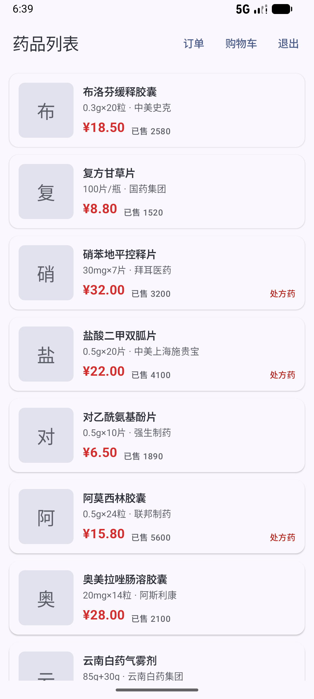
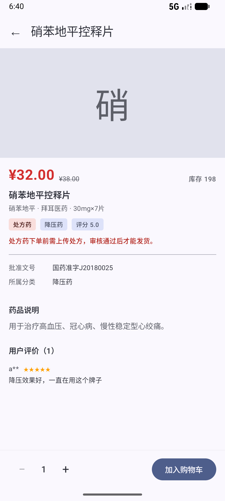
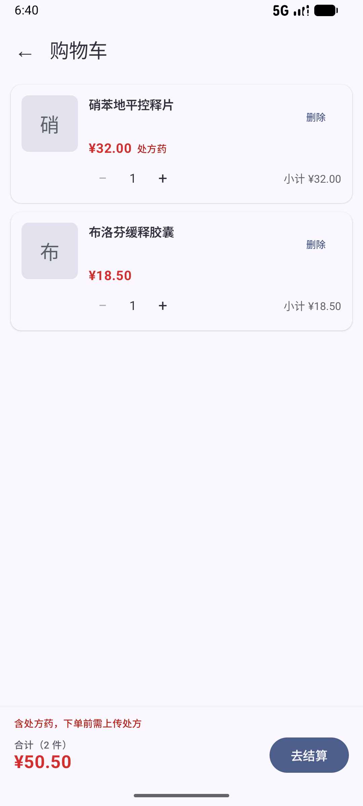
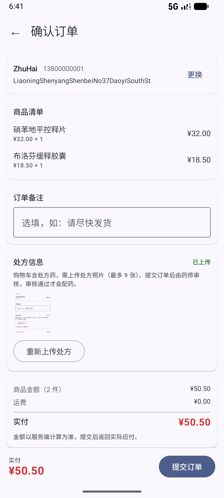
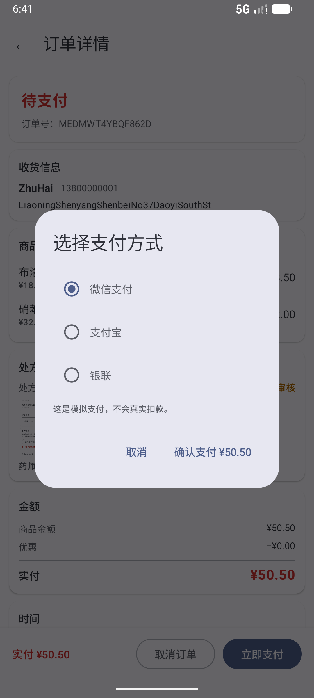
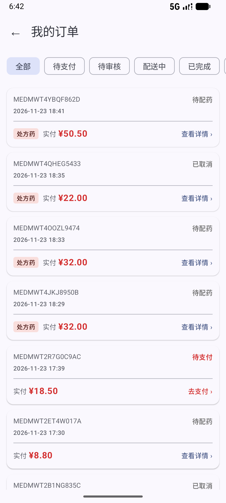
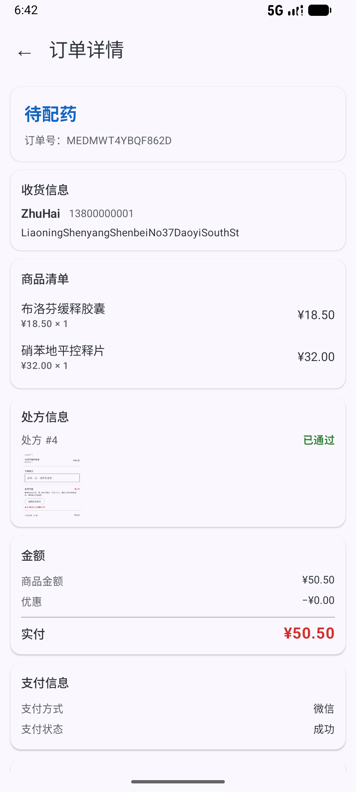

# 医药电商 Android 客户端

基于 **Jetpack Compose + MVVM + Retrofit** 的药品零售 App，对接自研 Spring Boot 后端，打通
**登录 → 浏览 → 详情 → 购物车 → 处方上传 → 下单 → 支付 → 药师审核 → 订单跟踪** 的完整业务链路。

不是静态 UI 演示：所有页面都连真实接口，库存扣减、乐观锁、Redis 缓存、处方审核状态流转都在后端真实发生。

| | |
|---|---|
| 语言 / UI | Kotlin 2.2.10、Jetpack Compose（Material 3） |
| 架构 | MVVM + 单向数据流（StateFlow） |
| 网络 | Retrofit 2.11 + OkHttp 4.12 + Gson |
| 最低版本 | Android 7.0（API 24），compileSdk / targetSdk 37 |
| 配套后端 | [medicine-online-system](https://github.com/rpcmzpz/medicine-online-system)（Spring Boot 2.7 + MySQL + Redis） |

## 界面

| 药品列表 | 处方药详情 | 购物车 |
|---|---|---|
|  |  |  |

| 结算（处方已上传） | 支付方式 | 订单列表 |
|---|---|---|
|  |  |  |

订单详情：支付后进入「待审核」，药师审核通过后页面**无需手动刷新**自动变为「待配药」。



## 功能

| 模块 | 已实现 |
|---|---|
| 认证 | 登录、JWT Bearer 自动注入、401 自动清理会话并退回登录页、退出登录清空返回栈 |
| 药品列表 | 分页加载（20 条/页）、触底自动加载、下拉刷新、库存/售罄状态、处方药角标 |
| 药品详情 | 价格与原价、库存、OTC/处方药标签、批准文号、说明书、用户评价、数量步进器、加入购物车 |
| 购物车 | 勾选状态、数量增减（乐观更新 + 400ms 防抖）、删除、金额实时汇总、含处方药提示 |
| 结算 | 收货地址切换/新增、订单备注、处方卡片、商品/运费/实付明细、提交前校验 |
| 处方 | 系统 Photo Picker 多选（最多 9 张，**无需存储权限**）、multipart 流式上传、缩略图预览、可重新上传 |
| 订单 | 6 个状态筛选、分页、下拉刷新、订单详情、支付（微信/支付宝/银联）、取消订单、确认收货 |
| 审核联动 | 待审核订单每 5 秒静默轮询，审核通过/驳回后自动更新状态、原因与按钮 |

## 架构

```
ui/             Compose 页面：有状态 Screen（拿 ViewModel）+ 无状态 Content（纯渲染）
 ├─ xxx/        ViewModel 持有 UiState，暴露 StateFlow
data/
 ├─ remote/     ApiService（Retrofit 声明）+ ApiClient（OkHttp）+ ApiCall（异常收敛）
 ├─ repository/ 组合接口调用，对上层只返回 ApiResult
 ├─ model/      与后端 JSON 一一对应的数据类
 └─ local/      TokenStore（SharedPreferences）
```

数据流是单向的：

```
用户操作 → ViewModel.fun() → Repository → ApiResult
                ↓
        _uiState.update { copy(...) }  →  Compose 重组
```

### 三个关键取舍

**1. 用 `ApiResult` 把「HTTP 异常」和「业务失败」收敛成一种类型**

后端统一返回 `{code, message, data}`，HTTP 状态码几乎恒为 200；但 401、网络断开、超时又是另一类失败。
如果每个 ViewModel 都自己 `try/catch + 判断 code`，会出现十份重复且不一致的错误处理。

```kotlin
sealed interface ApiResult<out T> {
    data class Success<T>(val data: T) : ApiResult<T>
    data class BusinessError(val code: Int, val message: String) : ApiResult<Nothing>
    data object NetworkError : ApiResult<Nothing>
    data object Unauthorized : ApiResult<Nothing>
}
```

`ApiCall.apiCall` 负责把 `HttpException`、`IOException`、业务 `code != 200` 全部映射到这四种结果，
`CancellationException` 原样重抛（吞掉它会让协程取消失效）。UI 层只需 `when` 四个分支。

写接口有个坑：后端成功时 `data` 是 `null`，如果按「data 非空才算成功」判断会被误判为失败。
所以拆出 `apiCallUnit`，只看 `code == 200`。

**2. 有状态 / 无状态两层拆分**

每个页面拆成 `XxxScreen`（创建 ViewModel、收集状态、处理导航和 Snackbar）和 `XxxContent`（只接收
`state` 和回调，无副作用）。`@Preview` 可以直接喂假数据渲染 `Content`，不需要起模拟器。

**3. 一致性由后端保证，客户端不重复计算**

下单只传购物车项 id 和地址 id，金额、库存、优惠全部由后端算；支付成功后重新拉详情，而不是本地改状态。
代价是多一次请求，好处是永远不会出现「客户端显示 ¥50.50、实际扣款 ¥52」这类对不上账的问题。

## 目录

```
app/src/main/java/com/zhuhai/medicine/
├── MedicineApplication.kt        # 进程级初始化 TokenStore
├── MainActivity.kt
├── data/
│   ├── local/TokenStore.kt
│   ├── model/                    # ApiResponse、Auth、Medicine、Cart、Order、Prescription、User
│   ├── remote/
│   │   ├── ApiClient.kt          # OkHttp（普通请求 / 上传请求两个 client）
│   │   ├── ApiService.kt         # 21 个接口声明
│   │   ├── ApiResult.kt
│   │   ├── ApiCall.kt            # 异常 → ApiResult
│   │   └── AuthInterceptor.kt    # 注入 Bearer，401 清会话
│   └── repository/               # 6 个 Repository
└── ui/
    ├── AppNavHost.kt             # 路由表 + 返回栈控制
    ├── login/ home/ medicine/ detail/ cart/ checkout/ order/
    ├── permission/               # Android 16+ 本地网络权限申请
    └── common/                   # 金额/日期格式化、multipart 构造
```

## 运行

### 1. 先启动后端

按 [medicine-online-system](https://github.com/rpcmzpz/medicine-online-system) 的 README 准备
MySQL 8 + Redis，`mvn spring-boot:run` 监听 3000 端口。

### 2. 配置后端地址

`data/remote/ApiClient.kt`：

```kotlin
private const val BASE_URL = "http://10.0.2.2:3000/"
```

- `10.0.2.2` 是 Android 模拟器访问宿主机的固定网关地址；
- **真机调试改成电脑的局域网 IP**（如 `http://192.168.1.10:3000/`），手机与电脑同一 WiFi；
- 末尾斜杠不能省，否则 Retrofit 拼出的路径会少一段。

### 3. 编译运行

Android Studio 打开工程直接 Run，或：

```bash
./gradlew :app:assembleDebug
adb install -r app/build/outputs/apk/debug/app-debug.apk
```

### 4. 创建测试账号

客户端目前只做了登录页，没有注册 UI（见「已知限制」），需要先调接口建一个账号：

```bash
curl -X POST http://localhost:3000/api/v1/auth/register \
  -H "Content-Type: application/json" \
  -d '{"username":"test001","password":"Test1234","phone":"13800000001"}'
```

然后用该账号登录。药师端审核可以用后端初始化的 `pharmacist / pharmacist123`。

### 5. 两个必须知道的联调前提

- **明文 HTTP**：Android 9+ 默认禁止 cleartext。工程内 `res/xml/network_security_config.xml`
  只对 `10.0.2.2` 与局域网段放行，未全局关闭。
- **Android 16（API 36+）的 `ACCESS_LOCAL_NETWORK`**：不声明该权限时，发往局域网的 SYN 会被
  系统静默丢弃，表现为 OkHttp 10 秒超时，而 `ping` / `nc` 却通（shell uid 不受限）。
  工程已在 Manifest 声明并在列表页首次进入时申请。

## 联调中定位并修复的问题

这一节是项目里最花时间的部分，也是最能说明「代码真的跑起来过」的部分。

| 现象 | 根因 | 处理 |
|---|---|---|
| 所有接口 10s 超时，但 `ping 10.0.2.2` 正常 | Android 16 新增 `ACCESS_LOCAL_NETWORK` 运行时权限，未授予时 SYN 被静默丢弃；shell 的 uid 不受该限制，所以命令行看着是通的 | Manifest 声明 + 首次进入列表页时申请，拒绝则展示引导页 |
| 上传处方报 `IOException: Stream Closed` | 日志拦截器 `Level.BODY` 会先 `writeTo(buffer)` 读一遍 body；流式 `RequestBody` 只能读一次，真正发包时已关闭 | 上传单独用一个 `Level.BASIC` 的 OkHttpClient，仍保留请求行/状态码/耗时 |
| 地址列表解析出 `addressId = 0`，结算页永远选不中地址 | 该接口手工拼 Map 返回**驼峰**，其余接口是**蛇形**，命名策略不一致 | `@SerializedName(value = "addressId", alternate = ["address_id"])` 同时兼容 |
| 新增地址报 `ClassCastException: Integer cannot be cast to Boolean` | 后端 `is_default` 用 `Boolean` 接收，客户端传了 `1` | 请求体字段改为 `Boolean` |
| 购物车连点 3 次 `+` 发出 3 个 PATCH | 没有合并请求 | 乐观更新 UI + 每个 cartId 一个 `Job`，400ms 内的新操作取消上一个 |
| 支付后返回列表，状态仍是「待支付」 | 列表只在首次组合时加载，返回时命中了返回栈里的旧页面 | `LifecycleEventEffect(ON_RESUME)` 静默刷新（保留旧列表，不闪白屏） |
| 下单 500，日志显示 `medicine_name` 不能为 null | 后端 `CartItemMapper` 联表查询漏了别名，MyBatis-Plus 的 `NOT_NULL` 策略跳过了该字段 | 后端补 `m.name AS medicine_name` |
| 所有表 `created_at` 为 NULL | 实体标了 `FieldFill.INSERT` 但没有 `MetaObjectHandler`，插入时显式写了 null，覆盖数据库默认值 | 后端新增统一填充器 |

后端侧的这些问题已单独提交在
[medicine-online-system](https://github.com/rpcmzpz/medicine-online-system) 的 commit 里。

## 测试

24 个 JVM 单元测试，不需要模拟器：

```bash
./gradlew :app:testDebugUnitTest
```

覆盖三类容易出错、又不需要真机的逻辑：

- **JSON 映射**：蛇形/驼峰两种键、`data: null` 的写接口、金额 `BigDecimal`、日期字符串；
- **`ApiCall` 分支**：HTTP 401 → `Unauthorized`、业务 code 非 200 → `BusinessError`、IO 异常 → `NetworkError`；
- **状态机规则**：哪些状态可支付、可取消、可确认收货，与后端 `pay` / `cancel` / `confirm` 的校验保持一致。

## 已知限制

这些是有意留下的边界，不是「没发现」：

- **注册 UI 未做**：`AuthRepository.register()` 已实现，只差页面；测试账号需用接口创建。
- **refresh_token 未自动续期**：Token 已持久化，但 401 时直接退回登录页，没有先尝试刷新。
- **搜索/分类/筛选未接 UI**：后端列表接口支持 `keyword` / `category_id` / `sort_by` / `drug_type`，客户端只用了分页。
- **无离线缓存**：断网时列表与详情直接报错，没有 Room 落库。
- **支付是模拟支付**：后端返回流水号，不接真实支付渠道。
- **处方驳回未联动退款**：订单会变为已取消并释放库存，但 `payments` 记录仍是成功状态。

## 关于这个项目

购药 App 是我为了补齐「能独立对接一个真实后端」这项能力做的：后端是此前完成的 Spring Boot 项目，
客户端从零学 Kotlin 和 Compose 写成。过程中最有价值的不是页面数量，而是上面那张排障表——
它逼着我去读后端的 Mapper、拦截器和状态机，也让我第一次意识到「接口文档没写的字段类型」
和「平台版本新增的权限」都能让一个功能静默失败。
